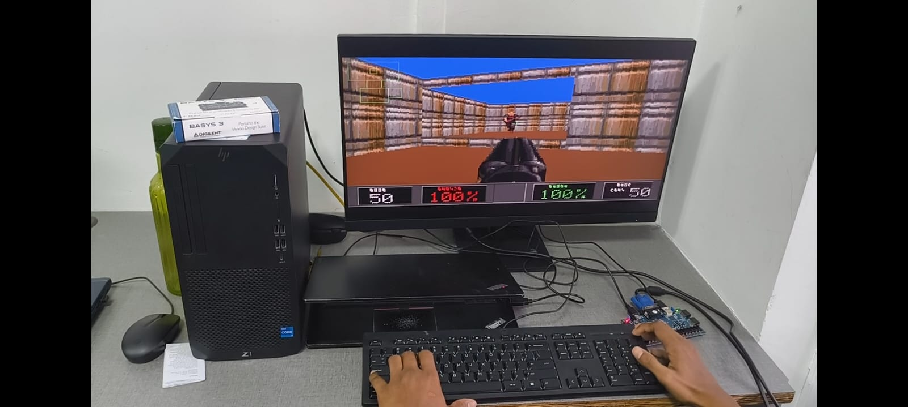

# DOOM on GEMMrv32: Repurposing a TinyML Edge AI Accelerator as a 3D Graphics Coprocessor

[-orange?style=flat-square)](https://digilent.com/reference/programmable-logic/basys-3/start)
[](https://riscv.org)
[](https://github.com/The-Silis-Foundation/GEMMrv32)
[](https://github.com/The-Silis-Foundation/GEMMrvStudio)
[-brightgreen?style=flat-square)]()
[]()

<p align="center">
  
</p>
<p align="center">
  <i>Live bare-metal execution on a Digilent Basys 3 FPGA: GEMMrv32 RISC-V SoC driving 640x480 @ 60 Hz VGA, with 3D entity geometry accelerated by hijacking an on-chip TinyML systolic GEMM accelerator. Developed and monitored using <b><a href="https://github.com/The-Silis-Foundation/GEMMrvStudio">GEMMrvStudio</a></b>.</i>
</p>

---

## 1. The Core USP: From TensorFlow Lite Inference to 3D GPU

In modern microcontroller-class chips, dedicated hardware matrix accelerators are designed strictly for **Edge AI and TinyML workloads**—evaluating quantized INT8 convolutions, dense layers, and GEMM primitives for models like TensorFlow Lite Micro. Meanwhile, microcontroller-class RV32 cores typically lack hardware floating-point units or vector extensions, making real-time 3D affine projection and trigonometric geometry computationally prohibitive.

**The Hack:** We hijacked the **GEMMrv32 8x8 Systolic GEMM Accelerator**—silicon engineered to accelerate neural network inference—and commandeered it as a **3D geometry coprocessor (GPU)**:

* Instead of neural network weight tensors, the coprocessor is loaded with a **$4 \times 4$ camera projection and view matrix**.
* Instead of activation feature maps, batches of 8 dynamic 3D world coordinate vectors are streamed into the array across its **256-bit wide DMA channel**.
* The systolic array evaluates the world-to-camera matrix transformations for all 8 entities in **under 85 clock cycles** ($66\times$ faster than software integer multiplication on the RV32IM core):

$$\begin{bmatrix} X_{cam} \\ Y_{cam} \\ Z_{cam} \\ 1 \end{bmatrix}_i = \begin{bmatrix} \cos\theta & -\sin\theta & 0 & 0 \\ \sin\theta & \cos\theta & 0 & 0 \\ 0 & 0 & 1 & 0 \\ 0 & 0 & 0 & 1 \end{bmatrix} \times \begin{bmatrix} X_{world} - X_{view} \\ Y_{world} - Y_{view} \\ Z_{world} - Z_{view} \\ 1 \end{bmatrix}_i$$

---

## 2. A Grounded Perspective: The 225 KB Silicon Ceiling (0 MB External DRAM)

In the legendary `itrunsdoom` community, DOOM has been ported to everything from pregnancy tests and digital cameras to toothbrushes and oscilloscopes. Running DOOM itself is not novel.

What makes this project an architectural feat is the **extreme silicon constraint**:

1. **Zero External RAM:** Most FPGA DOOM implementations target larger development boards with 64 MB to 128 MB of external DDR2/DDR3 SDRAM. The Digilent Basys 3 has **0 MB external DRAM**.
2. **The 225 KB Total Memory Limit:** The entire system—game code, data heap, monster state machines, BSP tree linedefs, the 19,200-byte dual-port VGA framebuffer, and the 256-color palette—fits strictly inside the Artix-7's **50 on-chip Block RAM tiles (225 KB total silicon budget)**:
   - Instruction Memory (IMEM): 32 KB – 64 KB
   - Data Memory (DMEM): 64 KB – 96 KB
   - Video Framebuffer (VRAM): 19,200 Bytes ($160 \times 120$ @ 8bpp)
   - Color Lookup Table (CLUT): 1,024 Bytes ($256 \times 12\text{-bit}$ RGB)
3. **Single-Buffered Rasterization:** Instantiating a second 64 KB framebuffer for standard double-buffering is physically impossible in 50 BRAM tiles. The engine employs **beam-synchronized rasterization** tied to the hardware VBlank register (`0x90010400`) to eliminate tearing without requiring a second buffer.

---

## 3. Developed with GEMMrvStudio

This project was built, compiled, packaged, and verified through **[GEMMrvStudio](https://github.com/The-Silis-Foundation/GEMMrvStudio)**, the dedicated IDE and hardware development environment for the GEMMrv32 SoC.

```
                      +-----------------------------+
                      |       GEMMrvStudio IDE      |
                      |  - C/C++ Firmware Editor    |
                      |  - Automated image_gen      |
                      |  - Live UART Console GUI    |
                      +-----------------------------+
                                     │
                     USB-UART Link   │  (19200 baud / Paced Loader)
                                     ▼
                      +-----------------------------+
                      |       Basys 3 FPGA Board    |
                      |  - GEMMrv32 RISC-V SoC      |
                      |  - 8x8 Systolic Coprocessor |
                      |  - Dual-Port VGA Scanout    |
                      +-----------------------------+
```

* **Project Orchestration:** GEMMrvStudio manages compilation of the `demo_vga_doom` firmware tree against the minimal NEORV32 C runtime.
* **Image Packaging:** Converts compiler ELF binaries into flat, bootloader-ready execution payloads with verified checksum headers.
* **Hardware Telemetry:** Direct serial streaming and non-blocking terminal monitoring over `/dev/ttyUSB1`, capturing live frame rates, player stats, and GEMM batch counts.

---

## 4. Hardware System Architecture

```
+-----------------------------------------------------------------------------------+
|                        BASYS 3 STANDALONE FPGA WORKSTATION                        |
|                                                                                   |
|   +---------------------------------------------------------------------------+   |
|   |                      GEMMrv32 RV32IM CPU @ 50.0 MHz                       |   |
|   |            64 KB Instruction BRAM      |   96 KB Data BRAM                |   |
|   +---------------------------------------------------------------------------+   |
|          │                                                       │                |
|          │ CFS Coprocessor Port (0xFFEA0000)                     │ Wishbone / XBUS|
|          ▼                                                       ▼                |
|   +--------------------------+                         +----------------------+   |
|   |  8x8 Systolic GEMM Unit  |                         |  Dual-Port VGA Core  |   |
|   |  (Edge AI NPU -> 3D GPU) |                         |  - 19,200 B VRAM     |   |
|   |  - 256-bit Wide DMA      |                         |  - 256 x 12b Palette |   |
|   |  - 66x Vector Speedup    |                         |  - 4x HW Scaler 60Hz |   |
|   |  - 3D Entity Projections |                         |                      |   |
|   +--------------------------+                         +----------------------+   |
|                                                                  │                |
|                                                                  ▼                |
|                                                            12-bit RGB DAC         |
|                                                            VGA Monitor (J1)       |
+-----------------------------------------------------------------------------------+
```

---

## 5. Engine & Gameplay Features

* **Authentic Id Software DOOM 2 Assets:** 256-color 12-bit RGB palette (`PLAYPAL`), wall textures (`STARTAN3`), and animated first-person **Super Shotgun** with twin muzzle flash.
* **Multi-Height BSP Linedef Traversal:** Front-to-back recursive tree walk through closed sector geometry with two-sided portals and steps.
* **Zero-Retention Column Rasterization:** `R_FillBackdrop()` guarantees 100% pixel coverage every frame, eliminating Hall of Mirrors (HOM) glitches and frame retention.
* **Dynamic Mobjs via GEMM Coprocessor:** Imp demons, Pinky demons, and Shotgunners batched through the systolic array for real-time billboard rendering and depth-buffered clipping.
* **Live Status HUD & Radar:** Animated Doomguy face with pain and grin states, health and ammo gauges, and a real-time 2D minimap with true-North orientation.

---

## 6. Quickstart: 100% Open-Source Toolchain

No proprietary Vivado tools are required to build, flash, or run this project.

### Step 1: Program the FPGA Bitstream (openFPGALoader)
Connect your Digilent Basys 3 via USB and run:
```bash
make flash-bit
# Or directly:
openFPGALoader --board=basys3 bit/neorv32_basys3.bit
```

To permanently flash the onboard SPI flash memory:
```bash
make flash-spi
```

### Step 2: Build the Firmware
Compile the game using the bare-metal RISC-V GCC toolchain:
```bash
make build
```
*Output binary generated at `bin/demo_vga_doom.bin`.*

### Step 3: Upload Firmware via Serial Bootloader
Connect to the Basys 3 serial port (`/dev/ttyUSB1` on Linux or `COM10` on Windows) at **19200 baud, 8N1**:
1. Press **`btnC`** (center button) on the Basys 3 to enter the bootloader.
2. Stream the binary:
   ```bash
   make upload SERIAL_PORT=/dev/ttyUSB1
   ```
3. Watch DOOM render live on your VGA monitor!

---

## 7. Controls

Dual-mode input is active across both the **Host PC Keyboard** (via serial terminal @ 19200 baud) and a physical keyboard connected to the **Basys 3 USB/PS2 Port (`J2`)**:

| Key | Action | Engine Response |
|:---:|:---:|:---|
| **`W`** | Move Forward | Translates camera along view vector with weapon bob |
| **`S`** | Move Backward | Translates camera backward with weapon bob |
| **`A`** | Turn Left | Rotates camera yaw left (counter-clockwise) |
| **`D`** | Turn Right | Rotates camera yaw right (clockwise) |
| **`SPACE` / `F`** | **Fire Super Shotgun!** | Fires 20 buckshot pellets with twin muzzle flash, deals 120 damage, triggers Doomguy grin |
| **`M`** | Toggle Minimap | Shows / hides the 2D radar overlay |
| **`R`** | Respawn / Reset | Resets player position, health (100), and ammo (50) |

---

## 8. Deep-Dive Engineering Reference

For the complete technical manual covering the memory map, MMIO registers, driver call flows, and detailed post-mortems of all 9 hardware and software anomalies solved during development, consult:

📖 [**`docs/DOOM-on-GEMMrv32-doc.md`**](docs/DOOM-on-GEMMrv32-doc.md)
