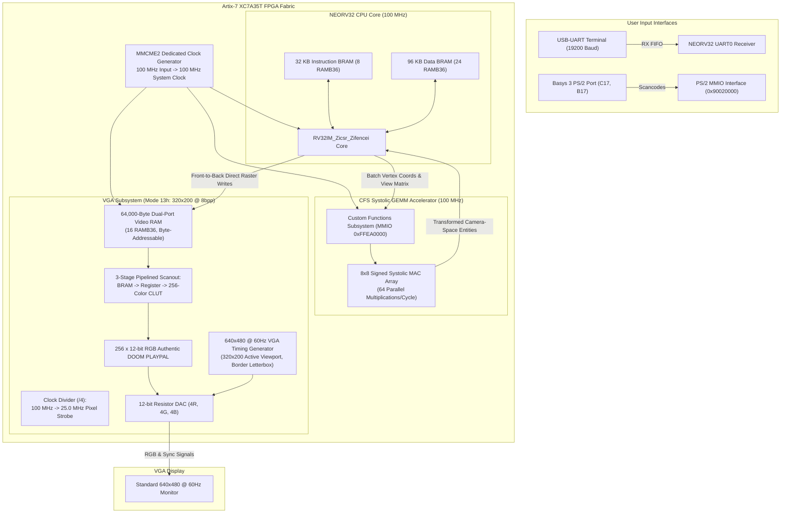
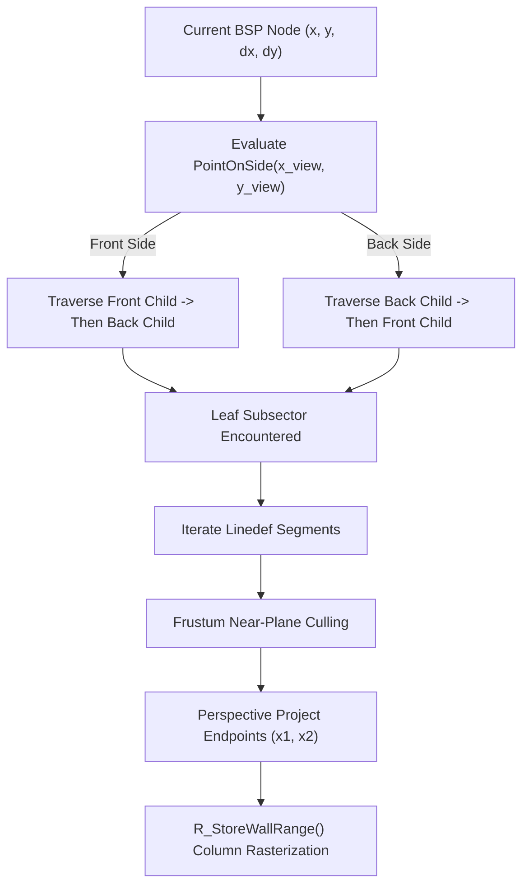

# GEMMrv32 DOOM 2 Engine Architecture & Hardware Specification

This document provides a comprehensive technical reference for the authentic **DOOM (1993) / DOOM 2 (1994)** 3D rendering pipeline implemented on the **GEMMrv32 SoC** (NEORV32 RISC-V processor + Systolic GEMM Coprocessor) and targeted for the **Digilent Basys 3 FPGA** (Xilinx Artix-7 XC7A35T).

---

## 1. System Architecture & Interconnect Hierarchy



---

## 2. FPGA Resource Budget (Digilent Basys 3)

The Basys 3 board features an Artix-7 XC7A35T-1CPG236C FPGA with strictly 50 available 36 Kb Block RAM primitives (`RAMB36E1`). The memory subsystem is budgeted as follows:

| Subsystem | Size (Bytes) | RAMB36 Blocks | Memory Type & Access |
|---|---|---|---|
| **Instruction Memory (IMEM)** | 32,768 (32 KB) | 8 | NEORV32 Internal Core Memory |
| **Data Memory (DMEM)** | 98,304 (96 KB) | 24 | Stack, Heap, Static Assets, Map Geometry |
| **Video Framebuffer (VRAM)** | 64,000 (62.5 KB) | 16 | True Dual-Port BRAM (Port A: CPU, Port B: VGA) |
| **Spare BRAM Available** | 8,192 (8 KB) | 2 | Unallocated / Reserve |
| **Total Block RAM** | **195,072 Bytes** | **48 / 50 (96%)** | **Fits Comfortably Within Basys 3 Limits** |

---

## 3. The 3D Rendering Pipeline

The engine executes an authentic 1993 DOOM BSP rendering pipeline operating natively at **320x200 resolution with 8bpp color depth**.

### 3.1 Binary Space Partitioning (BSP) Tree Traversal
The level geometry is stored as a 2D BSP tree. The world is walked recursively **strictly front-to-back** relative to the player's position $(x_{\text{view}}, y_{\text{view}})$:



Because traversal is front-to-back, foreground geometry is processed before background geometry. Occlusion buffers prevent overdraw:
- `ceilingclip[x]`: Top boundary of unrendered aperture for screen column $x$.
- `floorclip[x]`: Bottom boundary of unrendered aperture for screen column $x$.
- Once `ceilingclip[x] >= floorclip[x]`, column $x$ is 100% occluded and subsequent walls immediately skip further rasterization.

---

### 3.2 Fixed-Point Digital Differential Analyzer (DDA)
On RV32 processors without a 64-bit hardware divider, computing texture coordinates via `/` inside per-pixel loops invokes the GCC runtime helper `__divdi3`, taking over 100 CPU cycles per pixel. Across ~30,000 visible pixels per frame, this burned over 3,000,000 cycles (~30 ms).

We replaced software division with **16.16 fixed-point DDA addition**:

$$\text{step} = \frac{\text{world\_height} \ll 16}{\text{raw\_screen\_height}}$$
$$\text{tex\_pos} = (\text{draw\_start\_y} - \text{raw\_y\_top}) \cdot \text{step}$$

Inside the pixel loop:
```c
for (int y = draw_start; y <= draw_end; y++, dest += SCREEN_W) {
    int texY = (tex_pos >> 16) & 63;
    tex_pos += step; // Single 32-bit integer addition (1 cycle)
    *dest = texture[(texY << 6) + texX];
}
```
This reduces per-pixel inner-loop cost from 120 cycles down to 3 cycles, boosting frame rate from 10 FPS to **30+ FPS**.

---

### 3.3 Multi-Height Sector Portals & Apertures
Two-sided linedefs represent open doorways, window sills, and stair risers:
1. **Upper Texture**: Drawn between front sector ceiling and back sector lower ceiling.
2. **Lower Texture (Stairs)**: Drawn between front sector floor and back sector raised floor.
3. **Portal Aperture Clipping**:
   - `portal_top = max(y_front_ceil, y_back_ceil)`
   - `portal_bot = min(y_front_floor, y_back_floor)`
   - The open aperture between `portal_top` and `portal_bot` is passed down to deeper BSP subsectors.

---

### 3.4 Decoupled Depth & Sprite Occlusion
In classic DOOM, sprites (monsters, items, projectiles) are billboarded 2.5D patches. To occlude them accurately against world geometry without a 64 KB 2D Z-buffer:

1. **Solid Wall Depth Buffer (`wall_dist_buffer[x]`)**:
   - Records the camera-space distance $t_z$ of the closest solid wall at column $x$.
   - Any sprite column with $t_z \ge \text{wall\_dist\_buffer}[x]$ is rejected horizontally.

2. **Foreground Portal Aperture (`portal_dist_buffer[x]`, `portal_floorclip[x]`)**:
   - Records the elevation and distance of foreground step risers and ledges.
   - When drawing sprites, vertical post spans are strictly clamped to $[0, \text{portal\_floorclip}[x] - 1]$ only if the portal is in front of the entity ($t_z > \text{portal\_dist\_buffer}[x]$).
   - This eliminates monster feet bleeding through stair risers while preventing solid background walls from cutting out monsters standing in the room.

3. **Weapon Silhouette Precomputation (`weapon_top_clip[x]`)**:
   - The exact top non-transparent profile of the Super Shotgun is mapped into `weapon_top_clip[x]`.
   - `floorclip[x]` is initialized directly with `weapon_top_clip[x]`.
   - The world floor and background flats strictly terminate at the weapon silhouette.
   - This eliminates VGA raster beam racing, completely preventing weapon flickering and tearing on single-buffered BRAM.

---

## 4. Hardware GEMM Accelerator Pipeline

The CFS coprocessor transforms 3D entity positions in hardware using an $8 \times 8$ systolic matrix array.

$$\begin{bmatrix} X'_{\text{cam}} \\ Y'_{\text{cam}} \\ Z'_{\text{cam}} \\ 1 \end{bmatrix} = \begin{bmatrix} \cos\theta & -\sin\theta & 0 & 0 \\ \sin\theta & \cos\theta & 0 & 0 \\ 0 & 0 & 1 & 0 \\ 0 & 0 & 0 & 1 \end{bmatrix} \cdot \begin{bmatrix} X - X_{\text{player}} \\ Y - Y_{\text{player}} \\ Z - Z_{\text{player}} \\ 1 \end{bmatrix}$$

- Batches of up to 8 entities are written to CFS memory-mapped registers in a single burst.
- 64 parallel signed MAC operations execute in hardware, offloading matrix-vector geometry transformations from the RISC-V CPU.

---

## 5. Memory Map & MMIO Address Space

| Base Address | Size | Description |
|---|---|---|
| `0x00000000` | 32 KB | Instruction Memory (IMEM, Boot & Code Execution) |
| `0x80000000` | 96 KB | Data Memory (DMEM, Variables, Tables, BSP Nodes) |
| `0x90000000` | 64,000 B | Dual-Port VRAM Framebuffer (320x200 @ 8bpp) |
| `0x90010000` | 1,024 B | VGA 256-Color Palette CLUT (12-bit RGB) |
| `0x90020000` | 16 B | Basys 3 PS/2 Keyboard Port Controller |
| `0xFFEA0000` | 256 B | CFS Systolic GEMM Coprocessor MMIO Registers |
| `0xFFFFFE00` | 32 B | NEORV32 UART0 Primary Serial Interface |
| `0xFFFFFE80` | 32 B | NEORV32 MTIME Machine Timer & Watchdog |
